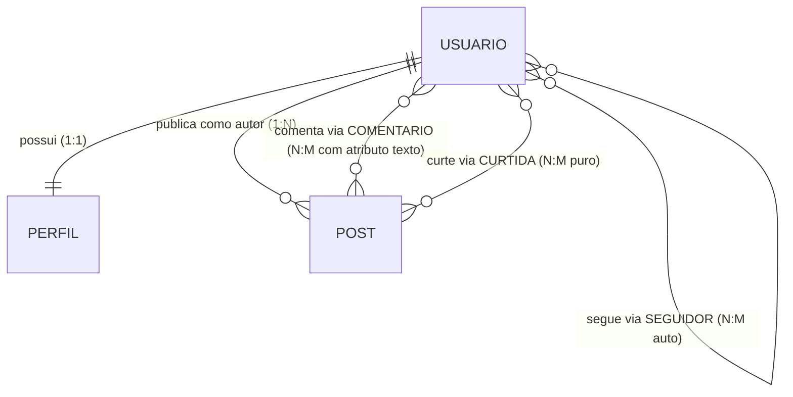

# Atividade 02 — APIs e Protocolos: Rede Social (REST/JSON vs. GraphQL)

**Disciplina:** Tópicos Especiais em Engenharia de Software (2026.2)  
**Protocolos escolhidos:** **REST (JSON)** e **GraphQL**  
**Stack:** Node.js + Express + GraphQL (`graphql` reference implementation)

---

## 1. Visão Geral e Estrutura do Projeto

Este projeto expõe **exatamente o mesmo domínio de uma Rede Social** (compartilhando a mesma camada de regras de negócio e banco em memória em [`src/domain/store.js`](./src/domain/store.js)) através de dois protocolos distintos:
1. **[`rest-json/`](./rest-json/README.md)** — Estilo arquitetural **REST (JSON)** orientado a recursos e verbos HTTP.
2. **[`graphql/`](./graphql/README.md)** — Linguagem de consulta declarativa **GraphQL** orientada ao grafo de entidades.

```text
exercicio-2-protocolos/
├── README.md                  # Visão geral, instruções de execução e comparação final
├── package.json               # Dependências e scripts (start, start:rest, start:graphql, test)
├── src/
│   ├── index.js               # Servidor unificado (REST em /api e GraphQL em /graphql)
│   └── domain/
│       └── store.js           # Domínio compartilhado (6 entidades, 5 comandos, 5 consultas e seed)
├── rest-json/
│   ├── README.md              # Documentação completa do REST + 10 exemplos copiáveis (req/res)
│   ├── routes.js              # Rotas e controllers REST (JSON)
│   └── server.js              # Servidor REST standalone
├── graphql/
│   ├── README.md              # Documentação completa do GraphQL + 10 exemplos copiáveis (req/res)
│   ├── schema.js              # Schema GraphQL (SDL: Types, Query, Mutation)
│   ├── resolvers.js           # Resolvers conectando o grafo ao domínio
│   └── server.js              # Servidor GraphQL standalone + interface GraphiQL
└── test/
    └── verify-all.js          # Suíte automatizada que valida as 10 operações nos 2 protocolos (20 testes)
```

---

## 2. O Domínio: Rede Social

O modelo de domínio implementa todas as **6 entidades** e seus relacionamentos especificados:



### Entidades
1. **`Usuario`**: `id`, `nome`, `email`, `criado_em`.
2. **`Perfil`** *(1:1 com `Usuario`)*: `id`, `usuario_id`, `bio`, `avatar_url`, `localizacao`.
3. **`Post`** *(1:N com `Usuario` autor)*: `id`, `usuario_id`, `texto`, `criado_em`.
4. **`Comentario`** *(N:M com atributo entre `Usuario` e `Post`)*: `id`, `usuario_id`, `post_id`, `texto`, `criado_em`.
5. **`Curtida`** *(N:M puro entre `Usuario` e `Post`)*: `usuario_id`, `post_id`, `criado_em`.
6. **`Seguidor`** *(N:M auto-relacionamento `segue` em `Usuario`)*: `usuario_id` (seguidor), `alvo_id` (seguido), `criado_em`.

### As 10 Operações Obrigatórias nos Dois Protocolos

| Categoria | Operação | REST (`http://localhost:3000/api`) | GraphQL (`http://localhost:3000/graphql`) |
| :--- | :--- | :--- | :--- |
| **Comando 1** | `criar_usuario(nome, email)` | `POST /api/usuarios` | `mutation { criar_usuario(nome, email) { ... } }` |
| **Comando 2** | `criar_post(usuario_id, texto)` | `POST /api/posts` | `mutation { criar_post(usuario_id, texto) { ... } }` |
| **Comando 3** | `comentar(usuario_id, post_id, texto)` | `POST /api/posts/:post_id/comentarios` | `mutation { comentar(usuario_id, post_id, texto) { ... } }` |
| **Comando 4** | `curtir(usuario_id, post_id)` | `POST /api/posts/:post_id/curtidas` | `mutation { curtir(usuario_id, post_id) { ... } }` |
| **Comando 5** | `seguir(usuario_id, alvo_id)` | `POST /api/usuarios/:usuario_id/seguindo` | `mutation { seguir(usuario_id, alvo_id) { ... } }` |
| **Consulta 1** | `buscar_usuario(id)` | `GET /api/usuarios/:id` | `query { buscar_usuario(id) { ... } }` |
| **Consulta 2** | `posts_do_usuario(usuario_id)` | `GET /api/usuarios/:usuario_id/posts` | `query { posts_do_usuario(usuario_id) { ... } }` |
| **Consulta 3** | `buscar_post(id)` | `GET /api/posts/:id` | `query { buscar_post(id) { ... } }` |
| **Consulta 4** | `seguidores_de(id)` / `seguindo_de(id)` | `GET /api/usuarios/:id/seguidores` e `/seguindo` | `query { seguidores_de(id) { ... } seguindo_de(id) { ... } }` |
| **Consulta 5** | `feed_do_usuario(usuario_id)` | `GET /api/usuarios/:usuario_id/feed` | `query { feed_do_usuario(usuario_id) { ... } }` |

> **Exemplos copiáveis de requisição e resposta para cada uma das 10 operações:**
> - 📄 **[Ver documentação e exemplos copiáveis de REST (`rest-json/README.md`)](./rest-json/README.md)**
> - 📄 **[Ver documentação e exemplos copiáveis de GraphQL (`graphql/README.md`)](./graphql/README.md)**

---

## 3. Instruções para Executar (Do Zero)

### Pré-requisitos
- [Node.js](https://nodejs.org/) (v18 ou superior)

### Passo a passo
No terminal, a partir desta pasta raiz:

```bash
# 1. Instalar as dependências do projeto
npm install

# 2. (Opcional) Rodar a suíte automatizada que valida as 10 operações em REST e as 10 em GraphQL
npm test

# 3. Iniciar o servidor unificado na porta 3000
npm start
```

Com o servidor rodando (`npm start`):
- **Visão Geral (JSON):** `http://localhost:3000/`
- **API REST (JSON):** `http://localhost:3000/api`
- **API GraphQL + Playground Interativo (GraphiQL):** `http://localhost:3000/graphql` *(abra no navegador para testar interativamente)*

Caso prefira subir apenas um protocolo por vez:
```bash
npm run start:rest     # Sobe apenas a API REST em http://localhost:3000/api
npm run start:graphql  # Sobe apenas a API GraphQL em http://localhost:3000/graphql
```

---

## 4. Comparação Final: REST (JSON) vs. GraphQL no Domínio de Rede Social

### Em uma linha: O que cada protocolo faz melhor nesse domínio?
- **REST (JSON):** É superior na **simplicidade de implementação e no uso nativo do protocolo HTTP** (códigos de status semânticos `201`/`404`/`409`, comandos diretos como `curtir`/`seguir` e cache HTTP por URL em recursos isolados como `GET /api/usuarios/:id`).
- **GraphQL:** É superior na **consulta declarativa do grafo social (`feed_do_usuario`, `buscar_post` e `seguidores_de` + `seguindo_de`) em uma única requisição**, eliminando o *over-fetching* e o *under-fetching* ao permitir que cada cliente selecione exatamente os campos e relacionamentos aninhados de que precisa.

---

### Análise Comparativa na Prática

| Critério | REST (JSON) | GraphQL | Vencedor na Rede Social |
| :--- | :--- | :--- | :--- |
| **Modelo Mental** | **Recursos e Verbos HTTP** (`/usuarios`, `/posts`, `GET`, `POST`) | **Grafo de Entidades Tipado** (`Query`, `Mutation`, seleção de campos) | **GraphQL** para leitura do grafo; **REST** para comandos simples |
| **Montagem do Feed (`feed_do_usuario`)** | Retorna um JSON fixo com todos os atributos de `Post`, `Autor`, `Perfil`, `Comentarios` e `Curtidas` (**Over-fetching** se a tela só exibe resumo, ou **Under-fetching / N+1** se o endpoint não aninhar tudo) | O cliente declara exatamente o que quer exibir no card do feed (ex.: `id`, `texto`, `autor { nome }`, `total_curtidas`), reduzindo o tamanho da resposta em mais de 60% | **GraphQL** |
| **Conexões (`seguidores_de` + `seguindo_de`)** | Exige **2 requisições HTTP separadas** (`GET /usuarios/:id/seguidores` e `GET /usuarios/:id/seguindo`) ou a criação de um endpoint específico sob medida | Busca **ambas as listas em 1 única requisição HTTP** combinando `seguidores_de` e `seguindo_de` na mesma `query` | **GraphQL** |
| **Comandos de Ação (`curtir`, `seguir`)** | Extremamente direto: `POST /api/posts/p1/curtidas` com `{"usuario_id": "u4"}` e retorno `201 Created` | Exige enviar o documento `mutation { curtir(...) { ... } }` especificando subcampos de retorno | **REST** |
| **Semântica de Erros** | Usa **HTTP Status Codes nativos** (`200`, `201`, `400`, `404`, `409`), facilitando monitoramento por proxies, API Gateways e CDNs | Retorna `200 OK` na camada HTTP mesmo em erros de domínio, encapsulando falhas dentro do array JSON `errors: [...]` | **REST** |
| **Cache de Rede** | Nativo via cabeçalhos HTTP (`ETag`, `Cache-Control`) por URL em `GET /api/usuarios/:id` e `GET /api/posts/:id` | Como todas as consultas usam `POST /graphql` no mesmo endpoint, o cache HTTP padrão não funciona sem clientes especializados (Apollo/Relay) ou *Persisted Queries* | **REST** |
| **Descoberta e Contrato (Schema)** | Não possui introspecção nativa no protocolo (depende de documentação externa como OpenAPI/Swagger) | **Schema fortemente tipado e introspectivo** nativo; ferramentas como o *GraphiQL* documentam e validam todas as entidades (`Usuario`, `Perfil`, `Post`, `Comentario`, `Curtida`, `Seguidor`) automaticamente | **GraphQL** |

---

### Quando usar cada um?

1. **Quando escolher REST (JSON):**
   - Quando a API expõe operações CRUD bem delimitadas e recursos independentes.
   - Quando se deseja aproveitar ao máximo a infraestrutura HTTP padrão (CDNs, cache por URL, observabilidade por status code `4xx`/`5xx`, rate-limiting por rota).
   - Quando os consumidores da API são conhecidos e têm necessidades de dados semelhantes, sem variações drásticas de tela.

2. **Quando escolher GraphQL:**
   - Quando o domínio é naturalmente um **grafo altamente conectado** (como uma Rede Social, onde `Usuario` se conecta a `Perfil`, `Post`, `Comentario`, `Curtida` e `Seguidor`).
   - Quando múltiplos clientes diferentes (App Mobile em rede móvel limitada, Web Desktop, Smartwatch) consomem a mesma API e cada um precisa de um recorte diferente dos dados no `feed_do_usuario`.
   - Quando se quer evitar a proliferação de endpoints acoplados a telas específicas (*BFF endpoints*) e eliminar múltiplas viagens de rede (*round-trips*).
